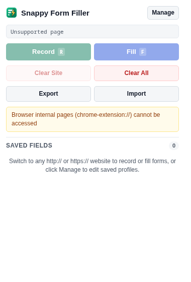
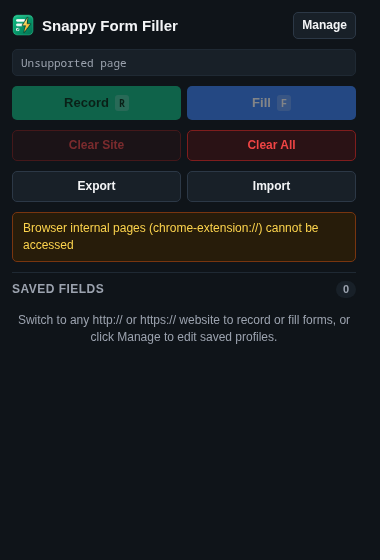
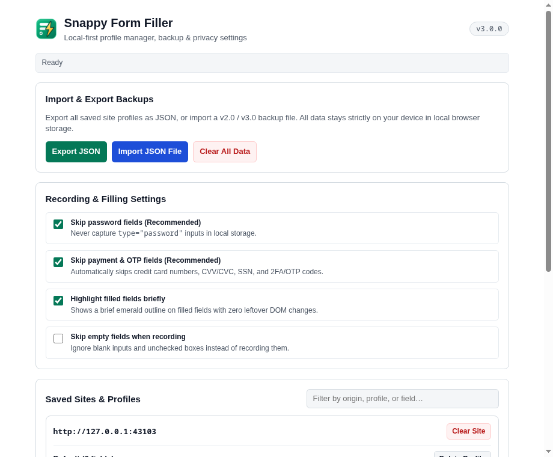
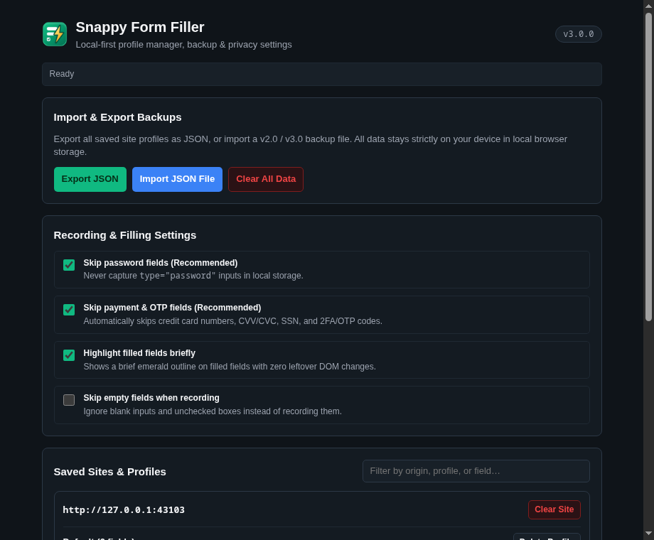

# Snappy Form Filler

> Record and replay form data across any website. Local-first per-site profiles with framework-aware filling for Chromium and Firefox.


## What It Does

Snappy Form Filler captures the values of HTML form controls (`<input>`, `<select>`, `<select multiple>`, `<textarea>`, checkboxes, radios, and open Shadow DOM controls) on the active tab, stores them locally per origin under named profiles, lets you inspect or edit values inline, and replays them back using native prototype setters compatible with **React, Vue, Angular, Svelte, and vanilla HTML**.

### Key Features

- **Per-site named profiles** — Keep multiple personas per origin (e.g., `Default`, `Admin`, `QA Edge Case`) with instant switching and automatic v2.0 migration.
- **Framework-aware filling** — Uses native `value`/`checked` prototype setters, React `_valueTracker` reset, and `input`/`change`/`blur` event dispatch with subtle highlight feedback.
- **Smart multi-strategy matching** — Matches fields reliably across dynamic SPA IDs (`:r0:`, `mui-123`) via `id` → `name` (+ index) → `data-testid` → `aria-label` / `<label>` → `placeholder` → CSS path, including open Shadow DOM.
- **Privacy & security by default** — Strictly minimal permissions (`activeTab`, `scripting`, `storage` — **zero** `<all_urls>` host permissions). Automatically skips passwords, credit card/CVV, OTP, CAPTCHA, and CSRF tokens unless explicitly opted in.
- **Validated JSON Import & Export** — Supports v2.0 and v3.0 backup files with safe **Merge / Replace All / Cancel** confirmation and prototype-pollution guards.
- **Accessible Light & Dark UI** — Keyboard shortcuts (`Alt+Shift+S` to open, `R` to Record, `F` to Fill), WCAG AA contrast, and a full-page Profile Manager & Settings tab (`options.html`).

## Screenshots

|                  Popup (Light)                   |                  Popup (Dark)                  |
| :----------------------------------------------: | :--------------------------------------------: |
|  |  |

|          Profile Manager & Settings (Light)          |         Profile Manager & Settings (Dark)          |
| :--------------------------------------------------: | :------------------------------------------------: |
|  |  |

## Quick Start (4 Commands)

Requires **Node.js >= 20**.

```bash
git clone https://github.com/mehad605/SnappyFormFiller.git
cd SnappyFormFiller
npm install
npm run build
```

Then load the built extension in your browser:

- **Chrome / Edge / Brave / Opera / Vivaldi / Arc:** Open `chrome://extensions`, enable **Developer mode**, click **Load unpacked**, and select `dist/chromium/`.
- **Firefox:** Open `about:debugging#/runtime/this-firefox`, click **Load Temporary Add-on…**, and select `dist/firefox/manifest.json`.

## Browser Support

| Browser                                  | Target           | Status          | Notes                                                                                                                                                       |
| ---------------------------------------- | ---------------- | --------------- | ----------------------------------------------------------------------------------------------------------------------------------------------------------- |
| Chrome, Edge, Brave, Opera, Vivaldi, Arc | `dist/chromium/` | Supported (MV3) | Service worker + popup/options file import                                                                                                                  |
| Firefox Desktop (>= 109)                 | `dist/firefox/`  | Supported (MV3) | Event page (`background.scripts`); popup Import opens full-page Profile Manager (`options.html#import`) because Firefox dismisses popups on OS file pickers |
| Firefox for Android (>= 120)             | `dist/firefox/`  | Supported (MV3) | Includes `gecko_android` config; responsive UI; global `_execute_action` shortcut ignored gracefully on mobile                                              |

## Common Scripts

| Command                                    | Purpose                                                                    |
| ------------------------------------------ | -------------------------------------------------------------------------- |
| `npm run dev`                              | Watch mode with sub-50ms esbuild rebuilds for Chromium & Firefox           |
| `npm run build`                            | Production build for `dist/chromium/` and `dist/firefox/`                  |
| `npm run build:chromium` / `build:firefox` | Build a single browser target                                              |
| `npm run package`                          | Create store-ready `.zip` (Chromium) and `.xpi` (Firefox) in `artifacts/`  |
| `npm run test`                             | Run unit & DOM tests (Vitest + happy-dom)                                  |
| `npm run test:e2e`                         | Run real Chromium/Brave & Firefox E2E smoke tests                          |
| `npm run check`                            | Run lint, typecheck, format check, unit tests, packaging, and size budgets |
| `npm run icons`                            | Regenerate all PNG icon sizes (16–512 px) from `assets/icons/icon.svg`     |

## Documentation

- [Architecture & Glossary](docs/ARCHITECTURE.md)
- [Contributing Guide & Good First Issues](CONTRIBUTING.md)
- [Feature Specification & Rationale](docs/FEATURES.md)
- [Architecture Decision Records (ADRs)](docs/decisions/)
- [Original Codebase Audit (v2.0)](docs/ANALYSIS.md)
- [Quality Scorecard](docs/SCORECARD.md)
