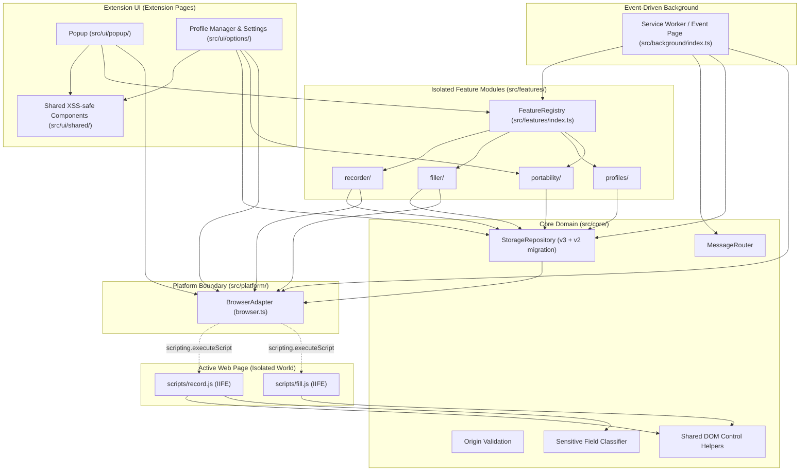
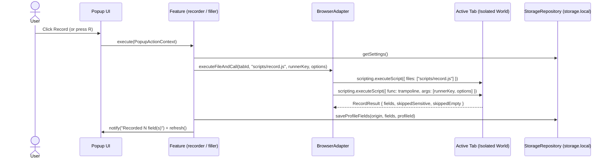

# Snappy Form Filler — Architecture Guide

This document explains how Snappy Form Filler v3.0 is structured so a new contributor can trace any flow and ship a safe change on day one.

## System Overview

Snappy Form Filler is a **zero-runtime-dependency, local-first Manifest V3** extension targeting Chromium (Chrome, Edge, Brave, Opera, Vivaldi, Arc) and Firefox (Desktop + Firefox for Android).



## Module Boundaries & Dependency Rules

| Layer          | Directory              | Allowed Imports                                                                     | Enforced By                                                    |
| -------------- | ---------------------- | ----------------------------------------------------------------------------------- | -------------------------------------------------------------- |
| **Core**       | `src/core/`            | Only `src/core/*`                                                                   | TypeScript + ESLint (`no-restricted-globals`)                  |
| **Platform**   | `src/platform/`        | Only `src/core/types.ts` + raw `browser`/`chrome` global                            | **Only directory permitted to touch `chrome.*` / `browser.*`** |
| **Features**   | `src/features/<name>/` | `src/core/*` only (**never** another `src/features/*` folder)                       | Code review + architecture tests                               |
| **UI**         | `src/ui/`              | `src/core/*`, `src/features/index.ts`, `src/platform/browser.ts`, `src/ui/shared/*` | ESLint (`no-restricted-syntax` bans `innerHTML`)               |
| **Background** | `src/background/`      | `src/core/*`, `src/features/index.ts`, `src/platform/browser.ts`                    | ESLint (`no-restricted-globals`)                               |

## Record & Fill Sequence



### Why Two-Step `executeFileAndCall`?

In v2.0, `chrome.scripting.executeScript({ func: frameworkAwareFill })` serialized a function that referenced a helper (`fieldLabel`) outside its closure, causing a fatal `ReferenceError` on any unmatched field. In v3.0:

1. esbuild compiles `src/features/recorder/page-entry.ts` and `src/features/filler/page-entry.ts` into self-contained IIFEs (`scripts/record.js` and `scripts/fill.js`).
2. `BrowserAdapter.executeFileAndCall` injects the bundle into the tab's **isolated world**, then invokes a tiny zero-closure trampoline that passes structured-clone arguments, executes the runner, and deletes the temporary isolated-world runner key immediately.

## Feature Module Contract

Adding a new feature requires **one new folder** (`src/features/<name>/`) and registering it in `src/features/index.ts`:

```ts
export interface FeatureModule {
  readonly id: string;
  readonly name: string;
  readonly description: string;
  readonly popupActions?: readonly PopupActionDescriptor[];
  readonly backgroundHandlers?: Readonly<Record<string, (payload: unknown) => Promise<unknown>>>;
}
```

See `src/features/_example-template/` for a working, tested template you can copy directly.

## Build Targets & Output Layout

Running `npm run build` produces two standalone unpacked extensions:

- `dist/chromium/` — targets Chrome, Edge, Brave, Opera, Vivaldi, Arc (`background.service_worker`, `minimum_chrome_version: "109"`).
- `dist/firefox/` — targets Firefox Desktop >= 109 and Firefox for Android >= 120 (`background.scripts`, `browser_specific_settings.gecko` & `gecko_android`).

Running `npm run package` compresses both into store-ready archives in `artifacts/`.

---

## Glossary of Browser Extension Terms

- **Manifest V3 (MV3):** The current browser extension platform specification used by Chromium and Firefox. Replaces persistent background pages with event-driven background scripts and tightens Content Security Policy (CSP).
- **Service Worker (Chromium) / Event Page (Firefox):** A background script that starts only when an event fires (`onInstalled`, `onMessage`) and shuts down automatically when idle, using zero RAM between events.
- **Popup (`popup.html`):** The compact HTML document rendered when a user clicks the extension toolbar icon or presses `Alt+Shift+S`. Closes automatically when focus leaves it.
- **Options UI (`options.html`):** A full browser tab registered via `options_ui` in the manifest. Used for full-page profile management, settings, and reliable JSON import on Firefox (where file pickers dismiss popups).
- **On-Demand Script Injection (`scripting.executeScript`):** Injecting a script into the active tab only when the user clicks Record or Fill, instead of running an always-on content script on every visited website.
- **Isolated World:** The sandboxed JavaScript execution environment where injected extension scripts run. They share the DOM with the web page, but have a completely separate `globalThis` so page scripts cannot inspect or tamper with extension variables.
- **`activeTab` Permission:** A privacy-preserving permission granting temporary access to the active tab _only_ after an explicit user gesture (clicking the toolbar button or pressing `_execute_action`). Avoids requesting scary `<all_urls>` host permissions.
- **`storage.local`:** On-device browser key-value storage scoped to the extension. Data never leaves the user's machine.
- **Content Security Policy (CSP):** Browser-enforced security rules restricting where scripts and styles can load from. Our policy (`script-src 'self'; object-src 'self'; style-src 'self'`) blocks all inline scripts, inline styles, `eval`, and remote code.
- **Native Prototype Setter:** Calling `Object.getOwnPropertyDescriptor(HTMLInputElement.prototype, 'value').set` directly to update input values in a way that frameworks like React (which override `.value` on input instances) detect when synthetic `input`/`change` events fire.
